# ascii.surf

[](https://github.com/AmirrezaAminrad/ascii.surf/actions/workflows/ci.yml)
[](LICENSE)

<p align="center">
  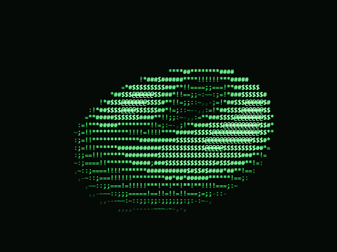
</p>

A real-time ASCII art renderer in the browser and in your terminal, inspired
by Andy Sloane's [donut.c](https://www.a1k0n.net/2011/07/20/donut-math.html).
Every frame is sampled into a character-cell z-buffer, so you can drag to
rotate, scrub time, tune light and lens, and watch the characters re-flow at
60 fps. 63 built-in shapes across surfaces, knots, polytopes, fractals,
attractors, simulations, and shaders, each with live parameters you can edit
as code. Style it with themes and character sets, then take the frame with
you: PNG, GIF, SVG, WebM, plain text, or a shareable URL.

## The app

<p align="center">
  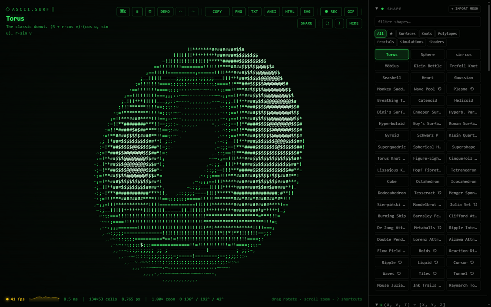
</p>

Open `Ctrl+K` and fuzzy-jump to any of the 111 commands — shapes, themes,
charsets, exports, and actions:

<p align="center">
  <table>
    <tr>
      <td align="center">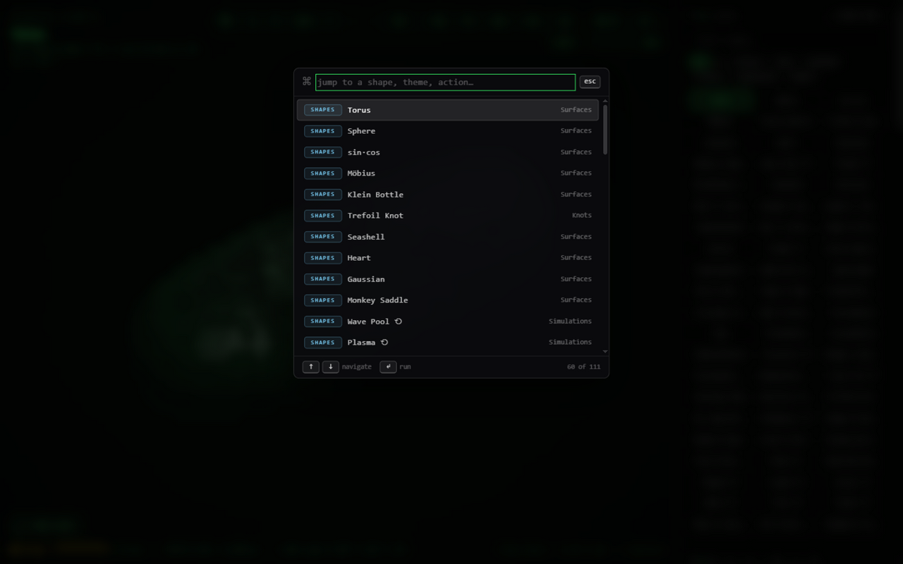<br><sub><b>Command palette</b></sub></td>
      <td align="center">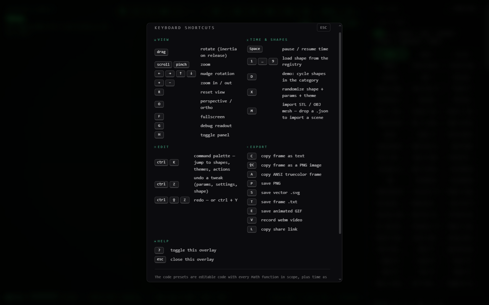<br><sub><b>Help overlay</b></sub></td>
    </tr>
  </table>
</p>

The scene boots in with a falling-rain intro:

<p align="center">
  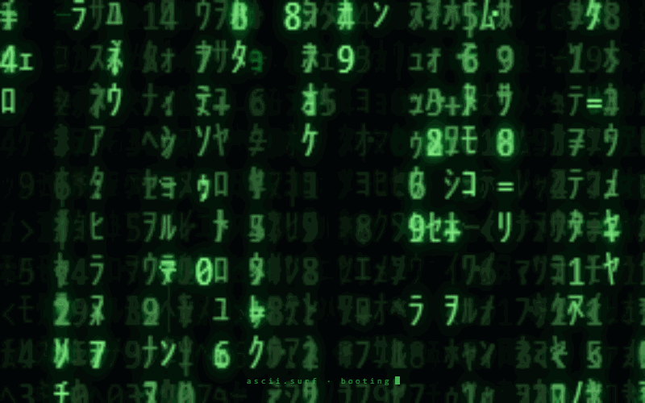
</p>

## Shape gallery

<p align="center">
  <table>
    <tr>
      <td align="center">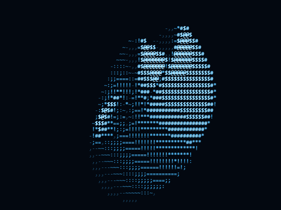<br><sub><b>Klein Bottle · Ice</b></sub></td>
      <td align="center">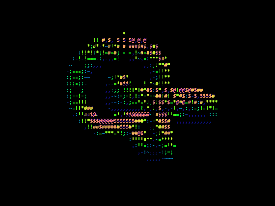<br><sub><b>Torus Knot · Rainbow</b></sub></td>
      <td align="center">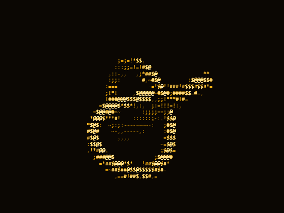<br><sub><b>Trefoil Knot · Amber</b></sub></td>
    </tr>
    <tr>
      <td align="center">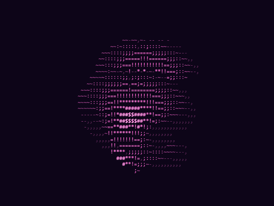<br><sub><b>Dini's Surface · Vapor</b></sub></td>
      <td align="center">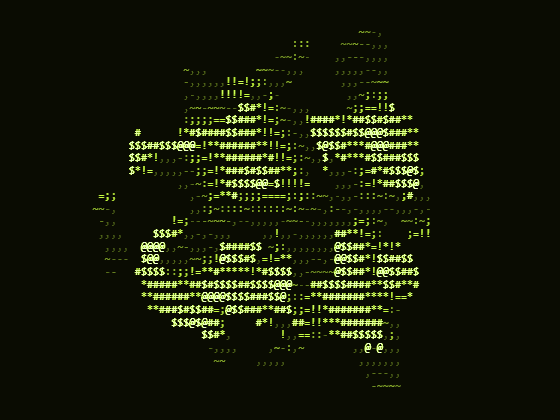<br><sub><b>Gyroid · Acid</b></sub></td>
      <td align="center">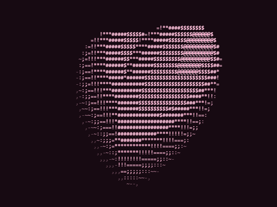<br><sub><b>Heart · Sakura</b></sub></td>
    </tr>
    <tr>
      <td align="center">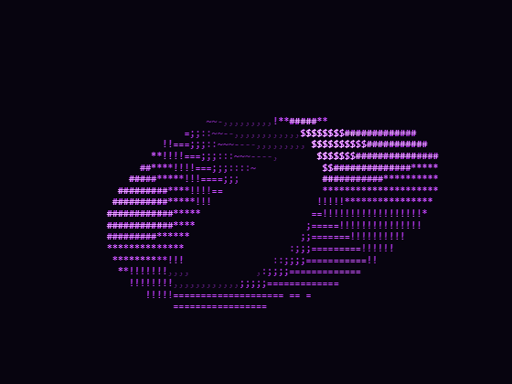<br><sub><b>Möbius · Plasma</b></sub></td>
      <td align="center">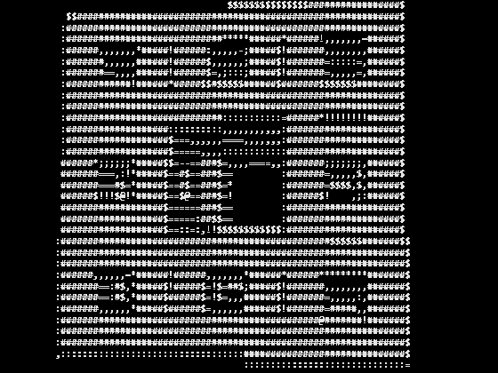<br><sub><b>Menger Sponge · Mono</b></sub></td>
      <td align="center">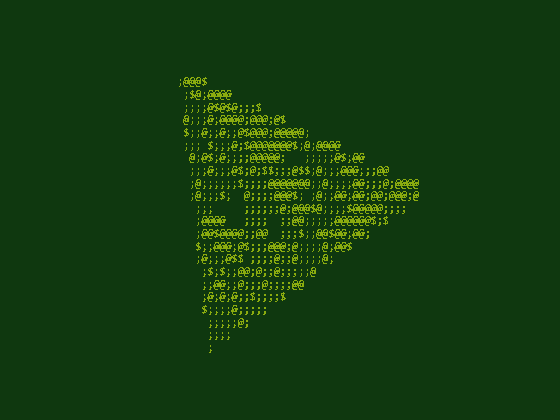<br><sub><b>Sierpiński Tetrahedron · Gameboy</b></sub></td>
    </tr>
    <tr>
      <td align="center">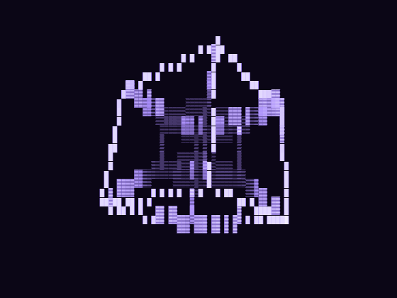<br><sub><b>Tesseract · Ultraviolet</b></sub></td>
      <td align="center">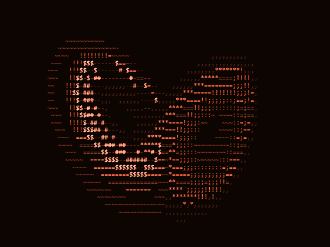<br><sub><b>Lorenz Attractor · Ember</b></sub></td>
      <td align="center">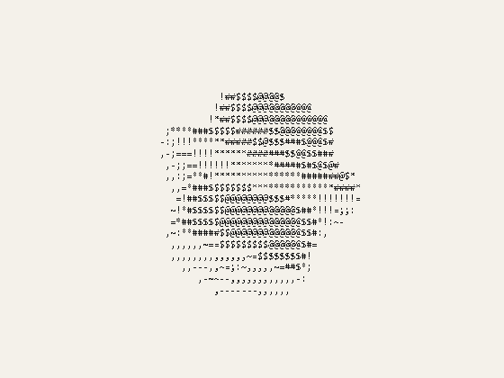<br><sub><b>Supershape · Paper</b></sub></td>
    </tr>
  </table>
</p>

## Themes

12 phosphor-inspired themes, plus a built-in editor for your own, 7 character
sets, and three color modes — with smooth crossfades between all of them:

<p align="center">
  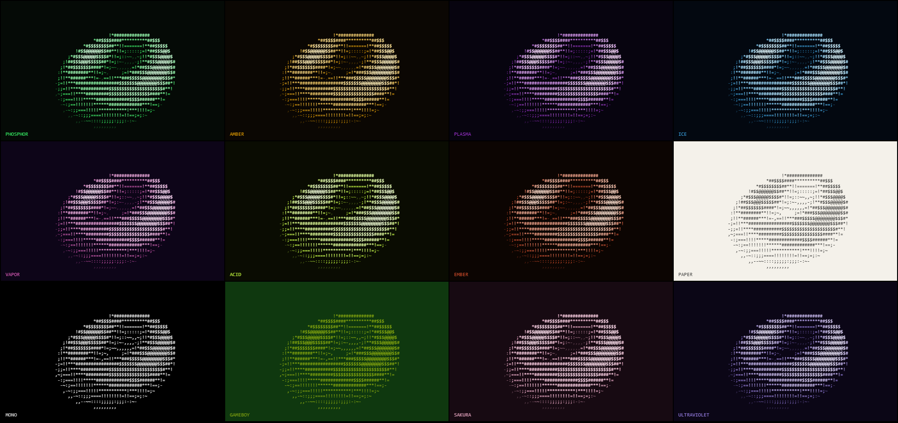
</p>

## Highlights

- **63 shapes, 6 categories** — Surfaces, Knots, Polytopes, Fractals,
  Simulations, and Shaders: torus, Klein bottle, trefoil and Lissajous knots,
  the Platonic solids and a tesseract, Menger sponge, Julia sets, Barnsley
  fern, Clifford and De Jong attractors, the Hopf fibration, Lorenz, boids,
  reaction–diffusion, and more.
- **Interactive pointer effects** — a liquid ripple sheet you can drop and
  stir, a FLIP-style ASCII fluid tank, a fading cursor trail, flowing noise
  waves, and a field of glassy glyph tiles; they all follow the pointer in
  the viewport and flow through themes, charsets, and exports like any
  other shape.
- **ASCII shaders** — the planar kind is a full screen-space shader: write
  `lum = f(u, v, t)` per character cell with mouse coordinates, zoom, and
  `prev(u, v)` frame feedback (trails, ink, feedback zooms). The presets range
  from a log-polar tunnel to a per-cell raymarched torus:

  <p align="center">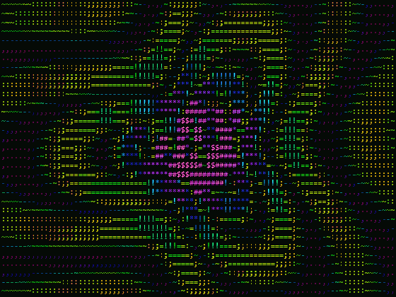</p>

- **Live code editing** — every shape kind is defined by a small function
  (`z = f(x, y, t)`, `F(x, y, z) = level`, `(u, v, t) → luminance`, a particle
  sim, …). Tweak the source in the side panel and the render updates instantly.
- **Camera & light** — orbit, zoom, orthographic/perspective toggle, movable
  light, depth fog, phosphor persistence trails.
- **Command palette** — `Ctrl+K` fuzzy-searches every shape, theme, charset,
  and action.
- **Mesh import** — drop in an `.stl` or `.obj` file and see it as ASCII.
- **Everything exports** — PNG (optionally transparent), SVG, plain text,
  animated GIF, WebM screen recording, plus one-click clipboard copies of the
  raw frame or ANSI-escaped text.
- **Shareable state** — the whole scene (shape, parameters, camera, theme)
  round-trips through a base64url URL. Undo/redo is built in.

## Terminal CLI

The same engine in your terminal — a live full-screen renderer plus a
pipe-friendly frame exporter.

<p align="center">
  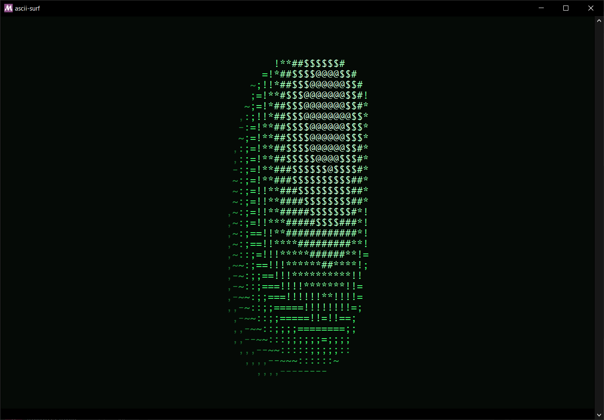
</p>

```bash
npm run cli                              # live: orbit with keys, mouse, wheel
npm run cli -- --shape lorenz            # pick any of the 63 shapes
npm run cli -- --once --no-color         # one plain-text frame → pipes & files
npm run cli -- --shape 1 --once --format svg --out torus.svg
npm run cli -- --list shapes             # index / id / name of every shape
```

See [cli/README.md](cli/README.md) for the full flag reference, keybindings,
and `--state` interop with the web app's share links.

## Getting started

```sh
npm install
npm run dev       # dev server
npm run build     # single self-contained HTML file in dist/
npm test          # vitest suite
npm run typecheck # tsc --noEmit (app + cli)
```

Requires Node 20+. CI runs typecheck, tests, and the production build on every
push and pull request.

## Keyboard shortcuts

| Key                 | Action                                      |
| ------------------- | ------------------------------------------- |
| `Ctrl+K`            | command palette                             |
| `Ctrl+Z` / `Ctrl+Y` | undo / redo                                 |
| `1`–`9`             | load shape by number                        |
| `space`             | pause / resume animation                    |
| arrows              | rotate view                                 |
| `+` / `-`           | zoom                                        |
| `r`                 | reset view                                  |
| `o`                 | toggle ortho / perspective                  |
| `x`                 | randomize everything (shape, params, theme) |
| `d`                 | demo mode                                   |
| `f`                 | fullscreen                                  |
| `h`                 | toggle side panel                           |
| `g`                 | debug overlay                               |
| `c`                 | copy frame as text (`Shift+C` — as PNG)     |
| `a`                 | copy frame as ANSI                          |
| `p` / `s` / `t`     | export PNG / SVG / TXT                      |
| `e` / `v`           | export GIF / record WebM                    |
| `m`                 | import mesh (STL/OBJ)                       |
| `l`                 | copy share link                             |
| `?`                 | help overlay                                |
| `Esc`               | dismiss overlay                             |

## Documentation

- [docs/rendering-pipeline.md](docs/rendering-pipeline.md) — the full
  pipeline, end to end, as four annotated Mermaid flowcharts: the shared
  engine, the web frame loop, the geometry dispatch, and the outputs.
- [docs/rendering-pipeline.svg](docs/rendering-pipeline.svg) — the same story
  as a one-page graphic (embedded below).
- [cli/README.md](cli/README.md) — CLI flags, keybindings, and snapshot mode.

## How it works

The renderer walks the shape's sample function, projects each point through
the current camera, and keeps the nearest hit per screen cell in a z-buffer.
Depth and surface normal then drive character selection and shading through
the active theme ramp, so the ASCII grid behaves exactly like a pixel frame
buffer — which is what makes rotation, fog, and persistence come out right.
One shared engine (`src/engine/renderer.ts`) feeds two frontends: the browser
canvas and the terminal's ANSI output.

<p align="center">
  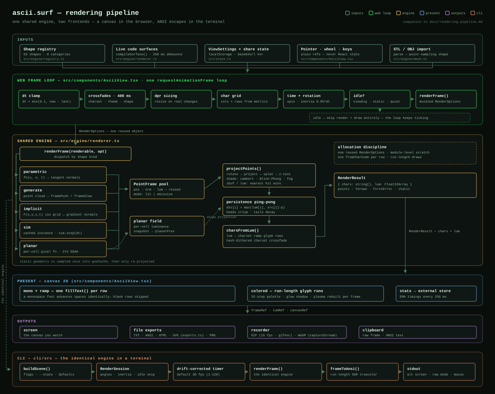
</p>

## Project structure

```
src/
  main.tsx              entry point
  App.tsx               UI shell: state atoms, shape/code editing, exports
  types.ts              shared app types (ViewSettings, Stats, ViewApi)
  state.ts              state codec + localStorage persistence (pure)
  themes.ts             built-in themes + custom-theme persistence
  utils.ts              clipboard / download helpers
  app/                  App state hooks
    useHistory.ts       undo/redo journal
    useDemoMode.ts      shape cycling
    useRecorder.ts      WebM recording + GIF export
    useScenes.ts        named state snapshots
    useCustomThemes.ts  user-built theme CRUD
    usePanelResize.ts   side-panel drag resize
    useShortcuts.ts     global keyboard map
  components/
    AsciiView.tsx       canvas viewport: render loop, zoom, crossfades
    Controls.tsx        panel primitives (Section, Slider, Switch, …)
    HelpOverlay.tsx     keyboard-shortcut overlay
    SidebarSections.tsx settings/scenes/theme panel sections
    CommandPalette.tsx  Ctrl+K fuzzy launcher
    StatusBar.tsx       fps/cell/time readouts
    BootRain.tsx        intro animation
    statsStore.ts       external fps store (renders outside React)
  engine/
    renderer.ts         point sampling → character-cell z-buffer → frames
    types.ts            shape/model types and code-gen helpers
    math.ts             RK4, tube sweep, noise, PRNG
    mesh.ts             STL/OBJ import
    presets.ts          the 13 editable code presets + charsets
    registry.ts         the full shape list and lookup
    exports.ts          frame → text/ANSI/HTML/SVG builders and palettes
    shapes/             native shapes by category
  view.ts               shared view math: zoom clamp, home orbit, idle-skip signature
cli/                    terminal sibling of the web app (see cli/README.md)
docs/                   rendering-pipeline.md + .svg, media/ (screenshots & gifs)
tools/capture/          screenshot and gif capture scripts for docs/media
```

## License

[MIT](LICENSE).
