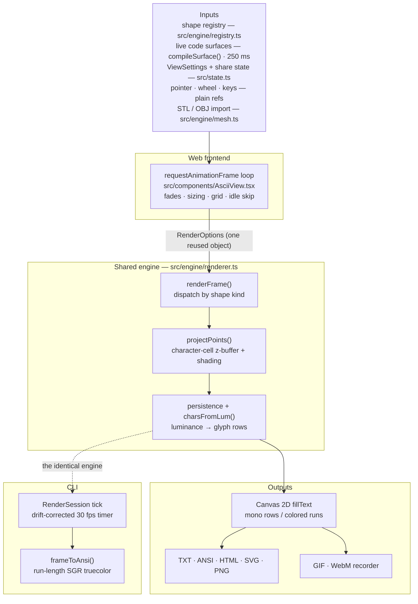
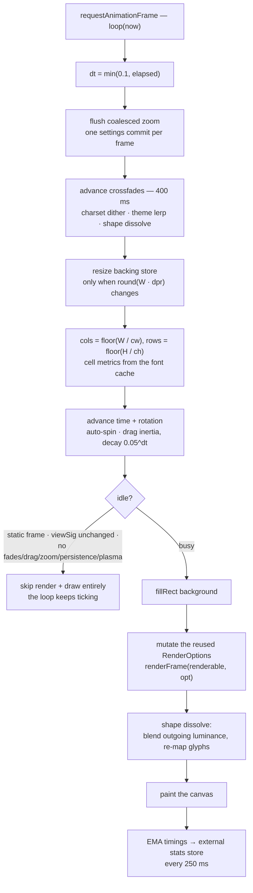
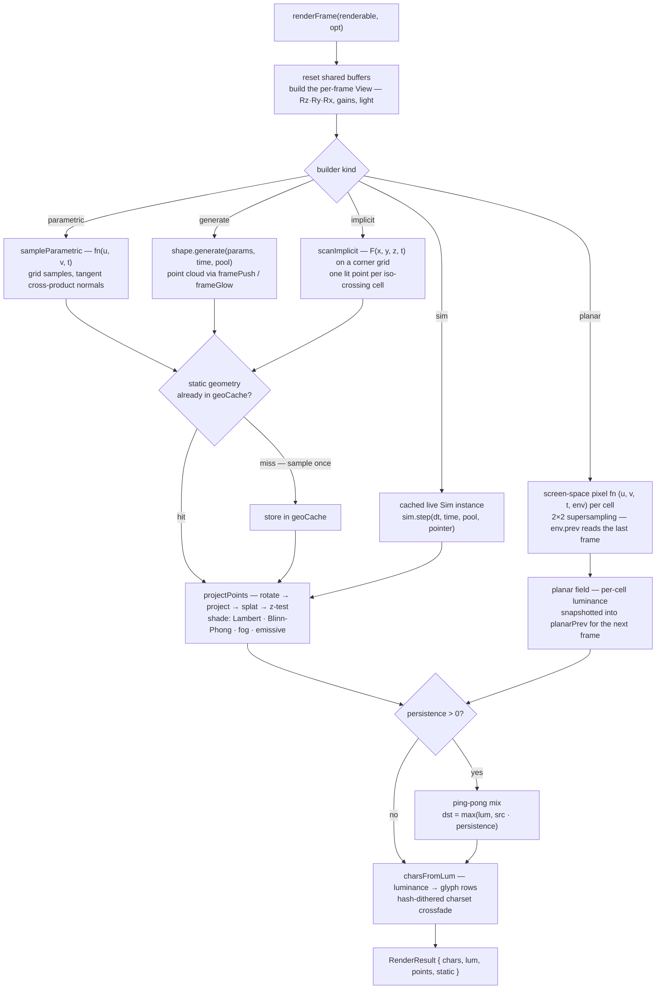
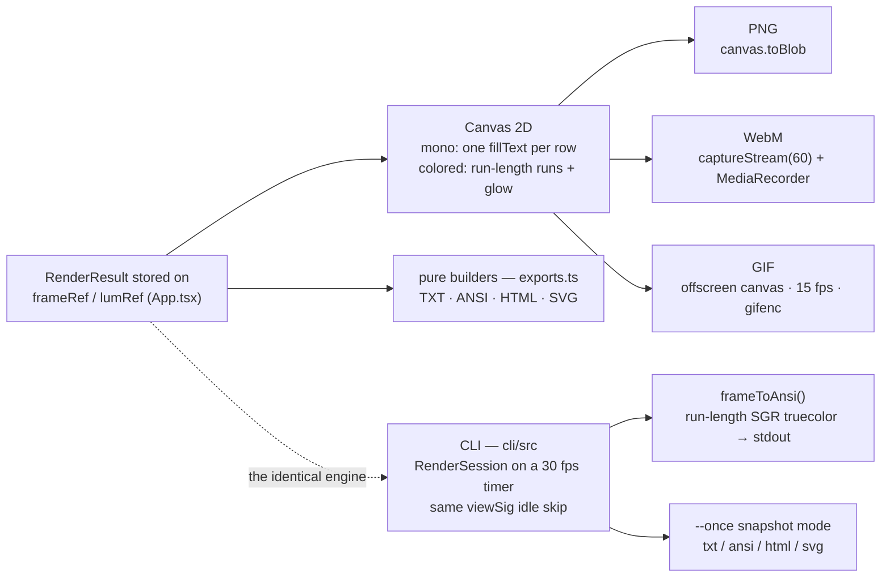

# The rendering pipeline

Every frame of ascii.surf travels the same road: state and input feed one
`requestAnimationFrame` loop, the loop hands a reused options object to a
shared engine, the engine samples the shape into a character-cell z-buffer,
post-processes it into glyphs, and the frontend paints those glyphs — on a
canvas in the browser, or as ANSI escapes in a terminal.

This is the diagram edition: four Mermaid flowcharts with short captions,
covering the whole pipeline end to end. A rendered one-page graphic of the
same story lives alongside it: [rendering-pipeline.svg](rendering-pipeline.svg).
The prose summary lives in the README's "How it works" section.

References use function names and repo-relative files; the two frontends are
`src/components/AsciiView.tsx` (web) and `cli/src/session.ts` (CLI), and the
engine they share is `src/engine/renderer.ts`.

## 1. The big picture

One shared engine (`src/engine/renderer.ts`), two frontends: the web frame loop
and the terminal CLI. Everything that can change the picture — the 63-shape
registry, debounced user code, settings and share state, pointer input, mesh
imports — feeds the same `requestAnimationFrame` loop, which talks to the
engine through a single reused `RenderOptions` object.

## 2. The web frame loop

`AsciiView.tsx` runs the only `requestAnimationFrame` loop. Each tick clamps
`dt`, flushes a coalesced zoom, advances the 400 ms crossfades, resizes the
canvas only when rounded device pixels changed, and derives the character grid
from cached font metrics. The idle check is what makes a still scene cost
nothing: a static frame with an unchanged `viewSig()` and nothing in motion
skips both render and draw while the loop keeps ticking.

## 3. Geometry dispatch: five builders, one rasterizer

`renderFrame()` resets the shared buffers (`zbuf.fill(-Infinity)`,
`lum.fill(-1)`) and builds the per-frame `View` — the combined `Rz·Ry·Rx`
rotation matrix, projection gains, and normalized light. The renderable then
dispatches on its builder kind; everything converges on `projectPoints()`,
except planar shapes, which are screen-space and fill the per-cell field
directly. Time-invariant geometry is sampled once into `geoCache` and only
re-projected afterwards.

## 4. Outputs: exports, recorder, and the CLI

The same `chars`/`lum` buffers feed every export — and, through the identical
engine, the terminal. The pure export builders in `src/engine/exports.ts`
consume the glyph rows directly; PNG is captured from the canvas; the recorder
(`src/app/useRecorder.ts`) taps the canvas stream for WebM and re-rasterizes at
15 fps, ≤ 420 px, through `gifenc` for GIF. The CLI (`cli/`) replays the
identical engine: `RenderSession` mirrors the web loop — same angles, inertia
and idle skip — on a drift-corrected 30 fps timer, and `frameToAnsi()`
translates the canvas drawing path to SGR truecolor escapes.

